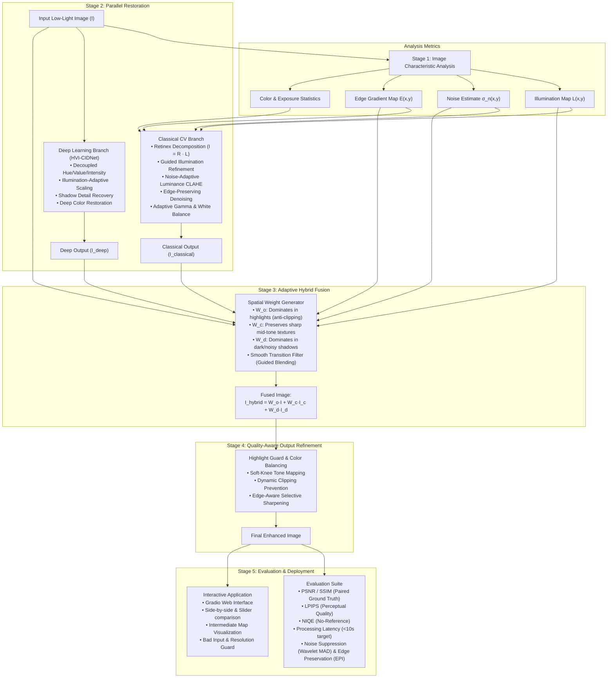

# System Architecture & Design Document: Problem Statement 1 (ProbID - P1)

## System Overview: Adaptive Retinex–HVI Restoration (ARHR)

The ARHR system is an illumination-adaptive hybrid restoration pipeline designed for low-light imaging challenges: extreme underexposure, sensor noise, non-uniform lighting, and color distortions.

### System Pipeline Architecture

---

## Technical Stages

### 1. Image Characteristic Analysis
* **Illumination Map $L(x,y)$**: Extracted through max-channel approximation or guided filtering in luminance space.
* **Noise Estimation $\sigma_n$**: High-frequency wavelet Median Absolute Deviation (MAD) in flat/shadow regions.
* **Edge Map $E(x,y)$**: Sobel / Scharr gradient magnitude.
* **Exposure Statistics**: Percentage of underexposed ($L < 0.15$) and clipped highlight ($L > 0.95$) pixels.

### 2. Classical Computer Vision Branch
* **Retinex Decomposition**: $I(x,y) = R(x,y) \cdot L(x,y)$.
* **Refinement**: Guided filtering preserves hard edges while smoothing illumination variations, eliminating Retinex halo artifacts.
* **Luminance CLAHE**: Contrast Limited Adaptive Histogram Equalization applied only to luminance ($V$ in HSV or $L^*$ in CIELAB) to avoid color shift.
* **Adaptive Denoising**: Bilateral / guided filtering parameterized inversely to local illumination (stronger denoising where $L$ is low and $\sigma_n$ is high).

### 3. Deep Learning Branch (HVI-CIDNet)
* Operates on decoupled representations to recover clean structural information without amplifying color noise.
* Utilizes pretrained checkpoints optimized on benchmark low-light datasets (LOL / LOL-v2).

### 4. Adaptive Spatial Fusion
* Spatially varying blending weights:
  $$I_{\text{hybrid}}(x,y) = W_o(x,y)I(x,y) + W_c(x,y)I_{\text{classical}}(x,y) + W_d(x,y)I_{\text{deep}}(x,y)$$
  subject to $W_o(x,y) + W_c(x,y) + W_d(x,y) = 1$.
* Avoids overexposure by giving high weight to $W_o$ in bright regions, avoiding deep learning artifacts in bright areas and classical noise amplification in deep shadows.

### 5. Quality-Aware Output Refinement
* Highlight guard preventing clipped channels ($>0.98$ intensity).
* Soft-knee tone mapping and conservative sharpening applied only in confident structural regions.
